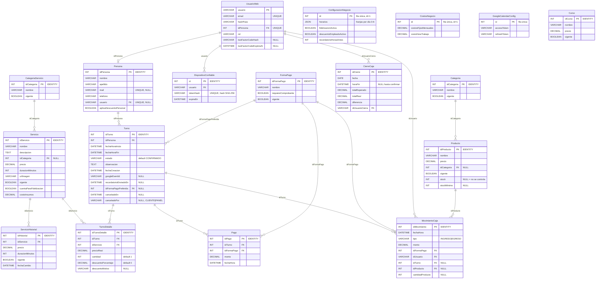
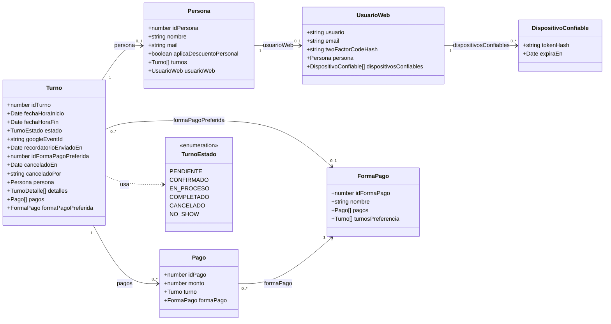
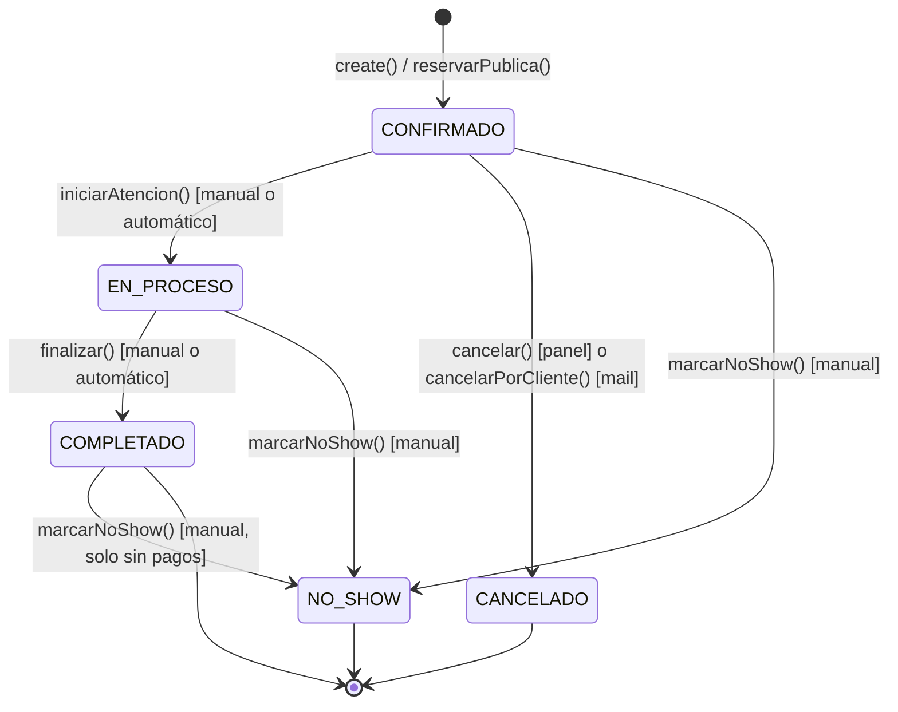

# CONTEXTO COMPLETO – Authentic Barber (Sistema de Gestión para Peluquería)

## Versión 2.1 (actualizado a partir del código real, 2026-11-01)

> **Novedades de la v2.1**: el cliente puede cancelar su turno desde el mail (con aviso al
> barbero), validación de teléfono y de duración de servicios, restricciones `CHECK` en la
> base, reportes de clientes para recontactar y de rentabilidad, stock de productos con
> venta desde la caja, y el botón "No vino" (el botón "Pagar" de la lista de turnos se sacó
> porque no registraba plata). Cada punto está detallado en la sección que corresponde.

> Este documento reemplaza la v1.0, que era el diseño inicial escrito **antes** de
> implementar el sistema. Después de esa primera versión se construyeron módulos enteros
> que no estaban previstos (branding/configuración del negocio, catálogo de productos,
> cursos, 2FA, integración con Cloudinary) y la estrategia del ciclo de vida del turno
> cambió por completo (ver sección 6). Las imágenes `.png` de esta carpeta
> (`DiagramaDeEstados-Turno.png`, `DiagramaDeSecuencia-*.png`, etc.) son del diseño
> original y **no reflejan el sistema actual** — quedan como referencia histórica. La
> fuente de verdad hoy son los diagramas Mermaid de este documento y de
> `diagrama-er.md` / `diagrama-clases.md` / `diagramas-procesos.md`, que se pueden
> visualizar directamente en GitHub o en cualquier editor con soporte Mermaid.

---

## 1. Descripción del Proyecto

Sistema de gestión integral para una peluquería con un único profesional (el dueño atiende
él mismo). Cubre la agenda de turnos (con reserva pública self-service), el catálogo de
servicios y productos, los cursos que ofrece el negocio, los pagos, los movimientos de
caja diarios, el cierre de caja, la configuración/branding del sitio público, y la
integración con Google Calendar y con un programa de fidelización.

El producto (marca comercial **SkillRdy**) se desarrolla y se licencia/renta a distintos
negocios de peluquería como clientes — cada cliente corre su propia instancia
(Docker Compose: base de datos + backend + frontend) en su propio servidor, no es
multi-tenant sobre una sola base de datos. El despliegue de referencia de este documento
(`Authentic Barber`) corre en un VPS fuera de Argentina, lo cual obligó a que toda la
lógica de horario de atención, huso horario y validación de turnos sea explícita
(UTC-3 fijo) y no dependa de la zona horaria del servidor — ver sección 6 y las notas de
desarrollo (sección 10).

---

## 2. Requisitos Funcionales

- **Gestión de Servicios**: ABM de servicios (corte, color, barba, etc.) con precio, duración, imagen y categoría. Guarda un historial (`ServicioHistorial`) cada vez que cambia precio, duración o vigencia, para no alterar el cobro histórico.
- **Gestión de Turnos**: Reserva pública self-service (con validación de disponibilidad y de horario de atención) y alta manual desde el panel. Ciclo de vida que avanza solo por reloj (ver sección 6); cancelar y marcar "No vino" quedan como las únicas excepciones manuales. "No vino" se puede marcar en turnos confirmados cuya hora ya pasó, en proceso, o completados sin pagos.
- **Cancelación por el cliente**: los mails de confirmación y de recordatorio traen un link firmado para que el cliente cancele solo, sin límite de horas mientras el turno no haya empezado. El horario se libera al instante y al barbero le llega un mail con los datos del cliente, la anticipación y un botón de WhatsApp. El turno guarda cuándo y desde dónde se canceló (`canceladoEn`, `canceladoPor`).
- **Gestión de Clientes**: Registro de personas con datos de contacto, historial de cortes e Instagram. Pueden marcarse para aplicar descuento de empleado. El teléfono se guarda normalizado (solo dígitos, sin el 0 inicial, entre 8 y 15) para que los links de WhatsApp y la búsqueda funcionen siempre.
- **Pagos**: Registrar pagos por turno, con múltiples formas de pago y pagos parciales/mixtos. El cliente puede elegir una forma de pago **preferida** al reservar online (obligatoria en ese flujo), que solo sirve para precargar el cobro en caja — nunca es el pago real.
- **Caja / Movimientos**: Registrar ingresos y egresos del día. Los ingresos se generan automáticamente al cobrar un turno (`CajaFacade.procesarPago`) o al vender un producto (`CajaFacade.venderProducto`, que además descuenta el stock); también se pueden registrar egresos sueltos (retiro de efectivo, compra de insumos).
- **Cierre de Caja**: Proceso en dos pasos (iniciar con el total esperado por forma de pago vía Strategy, confirmar con el conteo físico real), comparando lo esperado vs lo real.
- **Usuarios y Roles**: Autenticación con JWT + verificación en dos pasos por email (2FA), con opción de "recordar este dispositivo" por 30 días. Roles admin/peluquero (hoy solo hay un usuario, el modelo soporta extensión).
- **Configuración / Branding**: Panel para configurar horarios de atención (con franjas partidas por día), colores, logo, redes sociales, galería, textos de la landing, y qué secciones mostrar públicamente (tienda, cursos, club, etc.).
- **Programa de fidelización y descuento de empleado**: cada N visitas completadas de un servicio marcado para fidelización, la visita correspondiente se descuenta automáticamente; análogamente, una persona marcada como empleado puede tener un descuento activo. El cliente ve su progreso en los mails de confirmación y recordatorio ("Visita 3 de 5" o "¡Este turno tiene 50% de descuento!"), en `/reservar` al poner su email, y la regla en la página del Club; los servicios que suman se marcan con "Suma al club". El cálculo vive en `fidelizacion.util.ts` y usa el mismo conteo que aplica el descuento, sumando los turnos ya reservados antes del actual.
- **Catálogo de Productos y Cursos**: ABM de productos de tienda y de cursos informativos para la landing pública. Los productos tienen stock opcional: se venden en el local desde la caja, el dashboard avisa cuando quedan pocas unidades y la tienda muestra "Sin stock". Los cursos siguen sin integración de pago/inscripción.
- **Reportes**: resumen del período (ingresos, egresos, turnos, formas de pago, servicios y clientes más frecuentes), **rentabilidad** (margen, resultado, punto de equilibrio en turnos por mes y costo de la fidelización, a partir del costo de insumos de cada servicio y de los gastos fijos y el costo por hora cargados en `CostosNegocio`) y **clientes para recontactar** (los que dejaron de venir hace más de N días y los que nunca vinieron, con un botón de WhatsApp con mensaje armado).
- **Recordatorios automáticos**: email de recordatorio antes del turno (anticipación configurable), sin duplicar envíos. El negocio lo puede apagar desde Configuración → Marca → Notificaciones (`recordatorioActivo`).
- **Cupones de descuento**: el dueño crea un código (ej. `HOY20`) con porcentaje, vigencia (solo hoy, este mes o fechas a elección) y cupo opcional, y lo comparte por WhatsApp con un link que lo carga solo en `/reservar`. Cuenta el día en que se reserva, no el del turno; se usa una vez por email y cancelar el turno lo devuelve. No se acumula con otros descuentos: queda el mayor (si en la visita del club el descuento del club es mayor, lo reemplaza al completar el turno). Se ve en caja, en los mails y en Rentabilidad.
- **Aviso de nueva reserva**: cada turno que el cliente saca desde la web le llega por mail al negocio (email de contacto de Marca o, si falta, los usuarios del panel), con los datos del cliente, la forma de pago elegida y botones a la agenda y a WhatsApp. Los turnos cargados desde el panel no generan aviso.
- **Cumpleaños en la reserva online**: campo opcional, con la aclaración de que se usa para el beneficio de cumpleaños. Se pide al cliente nuevo y al existente que no lo tiene cargado; nunca pisa una fecha ya cargada.
- **Anticipación mínima para reservar online**: el negocio configura cuántos minutos antes se puede reservar desde la web (15 por defecto, de 0 a 1440). La página no ofrece horarios pasados ni dentro de ese margen y la API los rechaza; desde el panel no hay límite.
- **Integración con Google Calendar**: Sincroniza los turnos con el calendario de Google del negocio (OAuth2, una sola cuenta conectada, no por usuario).
- **Integración con Cloudinary**: subida de imágenes (servicios, productos, cursos, branding) desde el panel.
- **Integridad de datos**: validación en la API (DTOs) y restricciones `CHECK` en la base como segunda capa (estado del turno, montos, cantidades, porcentajes). Ver `diagrama-er.md`.

---

## 3. Diagrama Entidad-Relación (Base de Datos)

> Contenido idéntico al de `diagrama-er.md` — ver ese archivo para la descripción completa
> de entidades y relaciones, y el detalle de qué cambió desde la v1.0.

### Entidades (resumen)

- **CategoriaServicio** / **Servicio** / **ServicioHistorial**: catálogo de servicios y su historial de cambios.
- **Turno** / **TurnoDetalle**: la agenda. `Turno.estado` default `CONFIRMADO`; `idFormaPagoPreferida` es la sugerencia de pago del cliente; `canceladoEn`/`canceladoPor` registran la cancelación.
- **Persona** / **UsuarioWeb** / **DispositivoConfiable**: clientes, credenciales de acceso (con 2FA) y dispositivos de confianza.
- **FormaPago** / **Pago** / **MovimientoCaja** / **CierreCaja**: pagos y caja.
- **GoogleCalendarConfig** / **ConfiguracionNegocio** / **CostosNegocio**: filas de configuración única (`CostosNegocio` es interna y está separada porque `ConfiguracionNegocio` es pública).
- **Categoria** / **Producto**: catálogo de tienda, con stock opcional. Las ventas en caja quedan en `MovimientoCaja.idProducto`.
- **Curso**: catálogo informativo de cursos.

### Diagrama Mermaid

---

## 4. Diagrama de Clases (TypeScript)

> Contenido idéntico al de `diagrama-clases.md` — ver ese archivo para el diagrama completo
> del modelo de dominio **y** el diagrama separado de las clases de los patrones de diseño
> (State / Facade / Strategy).

### Enums

- **TurnoEstado**: `PENDIENTE` (legado, ya no se usa para turnos nuevos), `CONFIRMADO`, `EN_PROCESO`, `COMPLETADO`, `CANCELADO`, `NO_SHOW`.
- **MovimientoTipo**: `INGRESO`, `EGRESO`.

### Diagrama Mermaid (modelo de dominio, resumido — ver `diagrama-clases.md` para el completo)

---

## 5. Diagramas de Secuencia

> Contenido idéntico al de `diagramas-procesos.md` sección 1 — ese archivo tiene los 11
> diagramas completos (reserva pública, alta manual, cron de transiciones automáticas,
> login 2FA, cobro en caja, cancelar turno, cierre de caja, recordatorio automático,
> cancelación por el cliente, venta de productos y "No vino"). Acá solo el resumen de
> cuáles son y qué reemplazan:

| # | Diagrama | Reemplaza / es nuevo respecto a la v1.0 |
|---|----------|------------------------------------------|
| 1.1 | Reservar turno (sitio público) | Reemplaza "Agendar Turno" (antes era siempre por teléfono/presencial) |
| 1.2 | Alta manual de turno (panel) | Nuevo — separado del flujo público |
| 1.3 | Transición automática por reloj (cron) | **Nuevo** — el cambio de estrategia central de esta vuelta |
| 1.4 | Login con 2FA | Nuevo |
| 1.5 | Cobrar en caja | Actualizado — ya no pasa por un estado `PAGADO` separado |
| 1.6 | Cancelar turno | Actualizado — estados y reglas reales |
| 1.7 | Cierre de caja diario | Actualizado — proceso real en dos pasos con Strategy |
| 1.8 | Recordatorio automático por email | Nuevo |
| 1.9 | Cancelar turno desde el mail (cliente) | Nuevo en la v2.1 |
| 1.10 | Vender un producto en caja | Nuevo en la v2.1 |
| 1.11 | Marcar que el cliente no vino | Nuevo en la v2.1 |

---

## 6. Diagrama de Estados – Turno

**Cambio de estrategia (lo más importante de esta actualización)**: antes el turno nacía
`PENDIENTE` y necesitaba que alguien lo fuera confirmando, iniciando y finalizando a mano,
paso por paso. El dueño atiende él mismo y encadena turnos sin margen para ir tocando la
pantalla entre cliente y cliente, así que se cambió el enfoque: **el turno nace
`CONFIRMADO` y el sistema lo avanza solo, por el reloj** (`TurnosCronService`, cada 5
minutos) — `CONFIRMADO → EN_PROCESO` al llegar la hora de inicio, `EN_PROCESO →
COMPLETADO` al llegar la hora de fin. El dueño solo interviene a mano para las
excepciones reales: cancelar o marcar que el cliente no se presentó. Desde la v2.1 el
cliente también puede cancelar desde el mail, y "No vino" se acepta desde `EN_PROCESO` y
desde `COMPLETADO` si el turno no tiene pagos (sin eso no servía: para cuando el dueño se
daba cuenta, el cron ya había movido el turno). Esto fue posible
porque el chequeo de disponibilidad ya bloqueaba el horario desde que el turno entraba en
*cualquier* estado que no fuera `CANCELADO`/`NO_SHOW` — el paso `PENDIENTE` no aportaba
ninguna protección real que no diera ya el propio chequeo de solapamiento.

**Estados reales**: `CONFIRMADO`, `EN_PROCESO`, `COMPLETADO`, `CANCELADO`, `NO_SHOW` (más
`PENDIENTE` como estado de transición única para turnos de antes de este cambio).

> Contenido idéntico al de `diagramas-procesos.md` sección 2 — ver ese archivo para el
> diagrama completo con las notas de cada estado.

---

## 7. Diagrama de Actividades – Flujo del Día

> Contenido idéntico al de `diagramas-procesos.md` sección 3 — ver ese archivo para el
> diagrama completo. Resumen del cambio: antes todo el flujo asumía que el dueño agenda,
> inicia y finaliza cada turno a mano; hoy la mayoría de los turnos llegan agendados desde
> el sitio público y avanzan solos por el cron, y el dueño interviene sobre todo para
> cobrar, para los walk-ins, para vender productos en el mostrador, y para las excepciones
> (cancelar / "No vino"). Las cancelaciones del cliente llegan solas por mail.

---

## 8. Patrones de Diseño

**Principios base**: SOLID, DRY, KISS. **Filosofía**: Menos es más.

Esta sección se corrigió a partir de una revisión del código real (no solo de lo que se
había planeado). Hay tres patrones realmente implementados; dos que se habían documentado
en la v1.0 **no llegaron a implementarse** como tales, y se explica por qué no hizo falta.

### Patrones realmente implementados

| Patrón | Dónde está en el código | Qué resuelve |
|--------|--------------------------|---------------|
| **State** | `turnos/estados/turno-states.ts` + `turno-state.factory.ts` (`ITurnoState`, 6 clases: `PendienteState`, `ConfirmadoState`, `EnProcesoState`, `CompletadoState`, `CanceladoState`, `NoShowState`) | El ciclo de vida del turno. Cada estado sabe qué transiciones acepta y lanza `BadRequestException` en las demás. Tanto el panel (acción manual) como `TurnosCronService` (acción automática) llaman siempre a los mismos métodos del servicio — nunca escriben `estado` directo — así que **ninguno de los dos caminos puede dejar un turno en un estado ilegal**. Dos excepciones documentadas en `diagrama-clases.md`: "No vino" desde `COMPLETADO` sin pagos (depende de los pagos, no solo del estado) y la cancelación por el cliente (update condicionado para no duplicar el aviso). |
| **Facade** | `caja/caja.facade.ts` (`CajaFacade.procesarPago()` y `venderProducto()`) | `procesarPago()` coordina en una sola transacción: validar que el turno esté `COMPLETADO`, registrar el `Pago`, crear el `MovimientoCaja` (ingreso), y verificar si el turno quedó completamente pagado. `venderProducto()` hace lo mismo para una venta de mostrador: valida producto y forma de pago, descuenta el stock sin dejarlo negativo y crea el ingreso. El resto del sistema llama un solo método y no necesita saber cómo se arma cada operación por dentro. |
| **Strategy** | `caja/strategies/cierre.strategy.ts` (`ICierreStrategy` + `EfectivoStrategy`, `TarjetaStrategy`, `TransferenciaStrategy`, `OtrosStrategy`, con `getCierreStrategy()` como factory) | El cierre de caja calcula el total esperado por forma de pago sin un `if/else` gigante: cada estrategia sabe sumar sus propios movimientos (ingresos menos egresos del día). Agregar una forma de pago nueva no obliga a tocar el cálculo existente — como mucho, cae en `OtrosStrategy` hasta que se decida agruparla aparte. |

### Patrones documentados en la v1.0 que no se implementaron (y por qué no hizo falta)

| Patrón | Qué se había planeado | Por qué no se implementó así |
|--------|------------------------|-------------------------------|
| **Builder** | Construcción de `Turno` paso a paso para evitar constructores con muchos parámetros | El DTO de creación (`CreateTurnoDto`/`ReservaPublicaDto`) ya es un objeto plano con pocos campos obligatorios; no hay una construcción incremental real que un Builder resuelva mejor que un objeto literal. |
| **Adapter** (como clase formal) | Un `GoogleCalendarAdapter` que convirtiera `Turno` al formato de Google Calendar | Existe `GoogleCalendarService`, que funcionalmente hace ese trabajo (envuelve el cliente OAuth2 de `googleapis` y expone `createEvent`/`updateEvent`/`deleteEvent`), pero es un service de NestJS inyectado directamente, no una clase Adapter con una interfaz intercambiable. Nunca hubo necesidad real de soportar un segundo calendario (Outlook, etc.), así que no se formalizó. |
| **Observer / Mediator (event bus)** | `PagoCreadoEvent` disparando listeners en Caja y en Google Calendar, para que `TurnoService` no conozca a `CajaService` ni a `CalendarService` | Se evaluó, pero la comunicación entre módulos terminó siendo **inyección de dependencias directa** (`CajaFacade` inyecta `TurnosService`; `TurnosService` inyecta `GoogleCalendarService` y `MailService`). No hay `EventEmitter2`/`@OnEvent` en ningún lado del backend. Para el volumen de eventos real (un negocio, pocas decenas de turnos por día) el acoplamiento directo es más simple de seguir y debuggear que un event bus, y todavía no hay un caso real con múltiples listeners reaccionando al mismo evento que lo justifique. Si en el futuro se necesitara desacoplar más fuerte (por ejemplo, varios listeners reaccionando a un mismo pago), ahí sí valdría introducir `EventEmitter2`. |

### Patrones descartados (overkill para este proyecto, sin cambios respecto a la v1.0)

| Patrón | Razón de descarte |
|--------|-------------------|
| Abstract Factory | No hay familias de productos relacionados. Una función factory (como `getTurnoState`/`getCierreStrategy`) es suficiente. |
| Prototype | JavaScript tiene spread operator y `structuredClone`. No se necesita clonar manualmente. |
| Singleton | Angular y NestJS ya manejan sus servicios como singletons vía DI. No se implementa a mano. |
| Bridge / Composite / Flyweight | No hay jerarquías de abstracción complejas ni árboles de objetos masivos. |
| Proxy | NestJS ya tiene Interceptors, Guards (`JwtAuthGuard`) y Pipes (`ValidationPipe`, `ParseIntPipe`), y `@nestjs/throttler` para rate limiting. |
| Chain of Responsibility | Las validaciones usan `ValidationPipe`/DTOs o validadores explícitos en el service. |
| Command | No hay una cola de "deshacer" en la caja. |
| Memento | El historial se resuelve con `MovimientoCaja`/`ServicioHistorial`, no con snapshots de objetos. |
| Visitor | La estructura de objetos no es estable ni compleja. |
| Template Method | Strategy es más flexible y se alinea mejor con composición (preferible en TS a herencia forzada). |

---

## 9. Stack Tecnológico

### Frontend
- **Framework**: Angular 20, **standalone components**, **Signals en modo zoneless** (`provideZonelessChangeDetection()`), sin `zone.js`.
- **CSS**: Tailwind CSS 3 + **daisyUI 4** (se definió lo que en la v1.0 estaba pendiente de investigar).
- **Routing**: lazy-loaded por feature (`turnos`, `caja`, `personas`, `servicios`, `productos`, `reportes`, `configuracion`, `reservas` público, `landing` público, etc.).

### Backend
- **Framework**: NestJS 10.
- **Base de Datos**: PostgreSQL 16 (Docker, `postgres:16-alpine`).
- **ORM**: Prisma 5.8 (ver justificación en sección 9.1, sin cambios respecto a la v1.0).
- **Auth**: JWT (`@nestjs/jwt`) + `bcrypt` para contraseñas, + **verificación en dos pasos por email** con "recordar dispositivo" (`DispositivoConfiable`, tokens hasheados con SHA-256, cookie `httpOnly`).
- **Rate limiting**: `@nestjs/throttler` — límite global (120/60s) más límites específicos por endpoint público sensible (ej. `POST /turnos-publicos/reservar` a 5/60s).
- **Jobs programados**: `@nestjs/schedule` — `TurnosCronService` (`*/5 * * * *`, transiciones automáticas) y `NotificationsService` (`*/15 * * * *`, recordatorios).
- **Mail transaccional**: Resend (`resend` SDK) — confirmación de turno, recordatorio (los dos con link para cancelar), aviso de cancelación al barbero, código 2FA, reset de contraseña. Los datos que carga el cliente se escapan antes de meterlos en el HTML. Plantillas HTML inline con un objeto de branding compartido (`MARCA`), no un motor de templates separado.
- **Imágenes**: Cloudinary (`cloudinary` SDK) — subida server-side vía `multer` + `upload_stream` (no upload firmado desde el cliente).
- **Contenedores**: Docker Compose (`db` + `backend` + `frontend`/nginx) por cada cliente que licencia el producto.
- **API**: RESTful, documentada con Swagger (`@nestjs/swagger`).
- **Validación**: `class-validator` en los DTOs (con `ValidationPipe` global, `whitelist` + `forbidNonWhitelisted`) más restricciones `CHECK` en PostgreSQL.
- **Autenticación opcional**: `OptionalJwtAuthGuard` en endpoints públicos que muestran datos extra al panel (por ejemplo, `GET /servicios` solo devuelve `costoInsumos` con sesión).

### Integraciones
- **Google Calendar**: OAuth2 vía `googleapis`, una sola cuenta conectada por negocio (no por usuario). `TurnosService` llama a `createEvent`/`updateEvent`/`deleteEvent` envueltos en try/catch silencioso — si Google Calendar no está conectado o falla, no rompe la creación/cancelación del turno.
- **Cloudinary**: subida de imágenes para servicios, productos, cursos y branding.
- **Resend**: envío de todos los emails transaccionales.

### Huso horario (específico de este despliegue)

El backend puede estar hosteado en un servidor fuera de Argentina mientras el negocio
opera en hora de Argentina (UTC-3, sin horario de verano desde 2009). Esto se resolvió en
varios puntos a la vez, no solo con una variable de entorno:

- **Backend**: toda la lógica de horario de atención y de agenda usa aritmética UTC
  explícita con el offset fijo (`fecha-ar.util.ts`), sin depender de la zona horaria
  configurada en el proceso de Node.
- **Frontend**: cuando se construye un instante a partir de un `<input type="date">` +
  `<input type="time">` (alta manual de turno), se fija el offset `-03:00` explícito en el
  string ISO en vez de mandar un string ambiguo — necesario porque `Date` interpreta un
  string sin zona horaria como la hora local del entorno que lo lee (navegador o
  servidor), no como hora de Argentina.
- **Display**: el pipe `fechaAr` fuerza `America/Argentina/Buenos_Aires` con
  `Intl.DateTimeFormat` en vez de usar los getters locales del navegador (`getHours`,
  `getDate`, etc.), para que se vea igual sin importar desde qué dispositivo/huso horario
  se abra el panel.
- **Infraestructura**: `TZ=America/Argentina/Buenos_Aires` en los contenedores `db` y
  `backend` del `docker-compose.prod.yml`, principalmente para que los logs del servidor
  coincidan con la hora real del negocio.

### Consideraciones
- Cada instancia del sistema es para un único profesional — no hay multi-tenancy dentro de una misma base de datos; cada cliente que licencia el producto corre su propio stack.
- El frontend es responsive (uso desde tablet o celular en el local).

---

## 9.1. Justificación de la Elección del ORM: Prisma

*(Sin cambios respecto a la v1.0 — la decisión sigue vigente y el proyecto la confirma en producción.)*

### Contexto de la decisión

Se evaluaron dos opciones principales para el ORM: **Prisma** y **TypeORM**. Ambos son compatibles con NestJS, TypeScript y PostgreSQL, pero presentan diferencias fundamentales en arquitectura, developer experience y mantenimiento a largo plazo.

### Comparación directa

| Criterio | Prisma | TypeORM |
|----------|--------|---------|
| **Integración NestJS** | Excelente (`@nestjs/prisma`) | Muy buena (nativa) |
| **Tipado compartido con Angular** | **Perfecto** (genera interfaces automáticamente desde el schema) | Manual |
| **Modelo relacional simple** | Ideal | Funciona |
| **Patrón State (métodos en entidades)** | Requiere lógica aparte (ver más abajo) | Nativo en la clase entity |
| **Migrations** | **Automáticas y confiables** (`prisma migrate dev`) | Más manuales, menos confiables |
| **Curva inicial** | Muy baja (schema declarativo) | Media (decoradores + configuración) |
| **Docker / PostgreSQL** | Funciona igual | Funciona igual |
| **Mantenimiento del proyecto** | Activo, moderno, con releases frecuentes | Estancado, PRs sin mergear, bugs sin resolver |
| **Type safety** | **Muy fuerte** (genera tipos desde el schema) | Media (repositorios genéricos a veces fallan) |

### Ventajas de Prisma para este proyecto

1. **TypeScript nativo**: el schema declarativo (`schema.prisma`) genera tipos automáticamente.
2. **Developer Experience**: autocompletado perfecto en el IDE, `prisma migrate dev` confiable para iterar el modelo.
3. **Seguridad**: queries seguras por defecto (sin SQL injection).
4. **KISS**: el schema declarativo es más simple que decorar clases con `@Entity`, `@Column`, `@JoinColumn`.
5. **Eficiencia para un solo desarrollador**: permite iterar el modelo de datos en minutos.

### Cómo se resolvió en la práctica la "desventaja" de los objetos planos

La v1.0 proponía una capa de **Mapper** (`TurnoMapper.toDomain()`) para convertir el objeto
plano de Prisma en una entidad de dominio con métodos (`turno.iniciarAtencion()`). En la
implementación real **no se construyó ese Mapper**: el patrón State se arma al vuelo a
partir del string `estado` que ya trae el `Turno` de Prisma —
`getTurnoState(turno.estado)` devuelve el objeto de estado correcto, se le pide que valide
la transición (`estado.iniciarAtencion()`, que lanza si no es válida), y si no lanzó nada
se hace un `prisma.turno.update()` plano. Es una solución más liviana que la que proponía
la v1.0: cumple el mismo propósito (las reglas de transición no quedan sueltas como
`if/else` en el service) sin necesitar una capa de mapeo bidireccional completa.

### Desventajas de TypeORM (críticas para este proyecto)

- **Mantenimiento irregular**: PRs sin mergear, bugs sin resolver, releases espaciados.
- **Migraciones menos confiables**: puede generar migraciones incompletas o destructivas.
- **Type safety más débil**: los repositorios genéricos a veces no infieren tipos correctamente.
- **Configuración inicial**: requiere más boilerplate para configurar con NestJS.

### Conclusión

> **Se elige Prisma.** La decisión se mantiene después de meses en producción: las
> migraciones declarativas y el tipado generado automáticamente siguieron siendo el
> principal motivo para no migrar a TypeORM, incluso con el crecimiento real del schema
> (de 9 a 18 modelos).

---

## 10. Notas para el Desarrollo

- **ServicioHistorial** se crea automáticamente cuando cambia precio, duración o vigencia de un servicio (`servicios.service.ts`), para que el cobro histórico no se altere si el precio sube después — es el mismo propósito que `TurnoDetalle.precioReal` ya cumplía para cada turno puntual.
- **MovimientoCaja** tiene `idTurno` nullable porque pueden existir movimientos sin turno asociado (compra de insumos, retiro de efectivo).
- **CierreCaja** queda con `horaFin = NULL` mientras está "iniciado" pero no confirmado; una vez confirmado, queda con los totales reales y la diferencia calculada.
- **Pagos**: soportan pagos mixtos/parciales para un mismo turno (`Pago` es 1:N con `Turno`); `CajaFacade.procesarPago()` reporta si con ese pago el turno quedó completamente cubierto.
- **Turno nace `CONFIRMADO`, no `PENDIENTE`**: el chequeo de disponibilidad (transacción Serializable) ya bloquea el horario desde la creación; el paso `PENDIENTE` no sumaba protección real. `TurnosCronService` avanza automáticamente `CONFIRMADO → EN_PROCESO → COMPLETADO` por reloj; `CANCELADO`/`NO_SHOW` son siempre manuales.
- **Validación de horario de atención**: `create()`/`reservarPublica()` validan que el turno entre dentro de alguna franja de `configuracion_negocio.horarios` (no solo que no se solape con otro turno) — aplica tanto a la reserva pública como al alta manual del dueño, sin excepción.
- **Forma de pago preferida**: obligatoria solo en la reserva pública; nunca es el pago real, solo precarga el cobro en caja (que sigue siendo totalmente editable).
- **Huso horario fijo en UTC-3**, explícito en todo el stack (backend, frontend, infraestructura) — ver el apartado dedicado en la sección 9. Necesario porque el servidor puede estar hosteado fuera de Argentina.
- **2FA con dispositivo de confianza**: el código de 6 dígitos se guarda hasheado (SHA-256) con expiración de 10 minutos; el token de "recordar este dispositivo" también se guarda hasheado, con expiración de 30 días, en una cookie `httpOnly`.
- **Rate limiting por endpoint**: los endpoints públicos sensibles (reservar turno, login, reset de contraseña) tienen límites más estrictos que el resto, para no depender de un único límite global.
- **Fidelización y descuento de empleado**: ambos se calculan en `TurnosService` al completar un turno (`aplicarDescuentoFidelizacion`), no en un módulo separado — son reglas de negocio acopladas al ciclo de vida del turno, no al catálogo.
- **Google Calendar y Mail son siempre "best effort"**: ninguna falla de esas integraciones rompe la creación, cancelación o cobro de un turno (try/catch silencioso) — son conveniencias, no dependencias duras del flujo principal.
- **Link de cancelación**: `<FRONTEND_URL>/cancelar-turno?token=<idTurno>.<HMAC>`, con la clave derivada de `JWT_SECRET` (`cancelacion-token.util.ts`). No se guarda nada en la base: el mail de confirmación y el de recordatorio llevan el mismo link, y deja de servir cuando el turno ya no se puede cancelar. Si falta `FRONTEND_URL` o `JWT_SECRET`, los mails salen sin el botón. Cambiar `JWT_SECRET` invalida los links ya enviados (y también obliga a revincular Google Calendar).
- **Aviso de cancelación**: va al email de contacto de `ConfiguracionNegocio`; si está vacío, a todos los usuarios del panel.
- **Teléfonos**: `@IsTelefono()` (`common/decorators/is-telefono.decorator.ts`) normaliza a solo dígitos y sin el 0 inicial, y exige entre 8 y 15. Con letras se rechaza en vez de descartarse. Se aplica en clientes, reserva pública y registro.
- **`Persona.ultimoCorte` no se mantiene**: ningún código lo actualiza. El reporte de clientes inactivos calcula la última visita con el último turno `COMPLETADO`.
- **Rentabilidad**: costo variable de cada servicio = `costoInsumos` + `costoHoraTrabajo` × duración. Los gastos fijos se prorratean por días (mes de 30). Sin turnos completados no se calcula el promedio (sería dividir por cero) y se muestra un aviso. Los egresos de caja no se restan, para no contar dos veces lo que también se carga como costo.
- **Stock**: `Producto.stock = NULL` significa "no se controla". La venta descuenta con un `updateMany` condicionado a `stock >= cantidad`, así que nunca queda negativo aunque haya dos ventas a la vez.
- **Migraciones con datos reales**: el contenedor del backend corre `prisma migrate deploy` al arrancar, así que `scripts/verificar-checks.sql` hay que correrlo contra la base de producción **antes** de desplegar la imagen nueva. Si alguna fila viola un `CHECK`, la migración falla y el backend no levanta.

---

## 11. Archivos de este Proyecto

1. `diagrama-er.md` — Diagrama Entidad-Relación.
2. `diagrama-clases.md` — Diagrama de Clases (modelo de dominio + patrones de diseño).
3. `diagramas-procesos.md` — Diagramas de Secuencia, Estados y Actividades.
4. `contexto-proyecto.md` — Este documento (contexto completo, consolidado).
4.1. `../docs/diccionario-datos.md` — Diccionario de datos columna por columna, generado desde `schema.prisma` con `npm run docs:diccionario` (en `apps/backend`).
4.2. `../docs/manual-panel.pdf` — Manual de uso del panel para el dueño.
5. `DiagramaDe*.png` — Diagramas del diseño original (v1.0, pre-implementación). **Históricos, no actualizados**: no reflejan el sistema real. Se conservan como referencia de cómo arrancó el diseño, no como documentación vigente.

---

*Fin del documento de contexto.*
