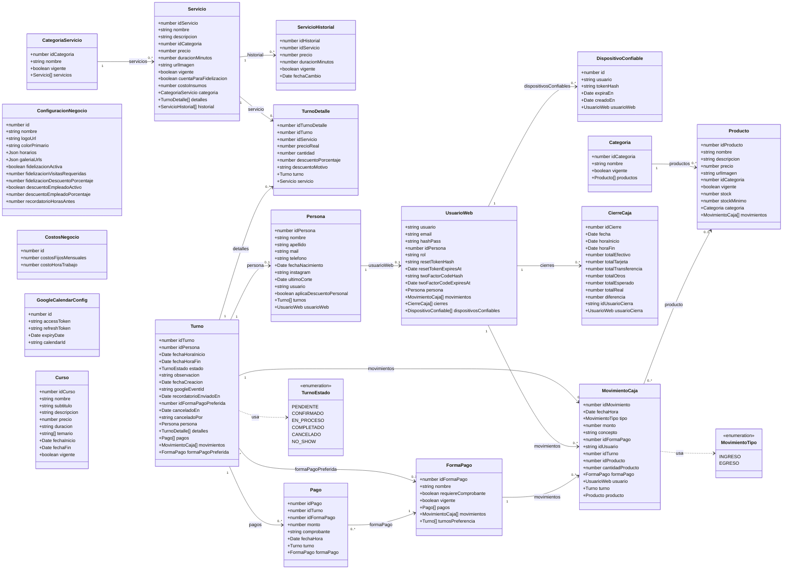
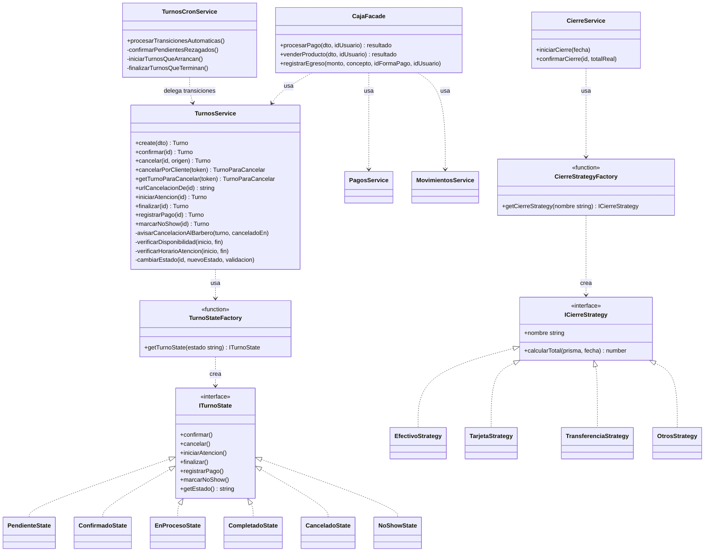

# Diagrama de Clases – Authentic Barber

## Versión 2.1 (actualizado a partir del código real, 2026-11-01)

Dos diagramas: el **modelo de dominio** (mismas entidades que `diagrama-er.md`, en forma de clase TS) y las **clases de los patrones de diseño realmente implementados** (State, Facade, Strategy — ver `contexto-proyecto.md` sección 8 para el detalle de cuáles se evaluaron y se descartaron).

---

## 1. Modelo de dominio

---

## 2. Clases de los patrones de diseño implementados

Los tres patrones que están realmente en el código (no solo documentados): **State** para el ciclo de vida del turno, **Facade** para el proceso de cobro, y **Strategy** para el cálculo del cierre de caja por forma de pago. Ninguno usa una capa de Mapper/entidad de dominio separada: el State pattern se arma al vuelo a partir del string `estado` que devuelve Prisma (`getTurnoState(turno.estado)`), no de un objeto rehidratado.

**Notas**:

- `TurnosCronService` (nuevo) nunca escribe `estado` directo: siempre llama a los métodos del servicio (`confirmar`/`iniciarAtencion`/`finalizar`), así que las transiciones automáticas pasan por la misma validación del patrón State que las manuales — el cron no puede dejar un turno en un estado ilegal.
- `TarjetaStrategy` agrupa "Tarjeta de Crédito" y "Tarjeta de Débito" en un solo total; `OtrosStrategy` es el catch-all para cualquier forma de pago que no sea Efectivo/Tarjeta/Transferencia (hoy, Mercado Pago).
- `EnProcesoState.marcarNoShow()` está permitido: como el cron pasa el turno a `EN_PROCESO` a la hora de inicio, un cliente que no vino casi siempre se detecta en ese estado. Desde `COMPLETADO` el State lo rechaza, pero `TurnosService.marcarNoShow()` hace una excepción explícita si el turno **no tiene pagos** (lo cerró el cron por horario sin que nadie lo atendiera). Es la única regla de transición que depende de datos fuera del estado, por eso vive en el service y no en la clase de estado.
- `cancelarPorCliente(token)` no pasa por `getTurnoState().cancelar()`: hace un `updateMany` condicionado a `estado IN (PENDIENTE, CONFIRMADO)` para que dos clics simultáneos (o el cron pasando el turno a `EN_PROCESO` en el mismo momento) no generen dos avisos al barbero. El token es un HMAC del id del turno firmado con `JWT_SECRET` (`cancelacion-token.util.ts`), sin guardar nada en la base.
- `CajaFacade.venderProducto()` crea el `MovimientoCaja` y descuenta el stock en una sola transacción. El descuento es un `updateMany` condicionado a `stock >= cantidad`, así que dos ventas simultáneas de la última unidad nunca dejan el stock negativo.
- `registrarPago(id)` sigue existiendo en el backend (`POST /turnos/:id/pagar`), pero el panel ya no lo usa: no registraba plata. El cobro real es siempre `CajaFacade.procesarPago()`.
- Ver `contexto-proyecto.md` sección 8 para qué patrones se evaluaron y se descartaron (Builder, Adapter como clase formal, Observer/Mediator vía event bus) y por qué.

---

*Ver también: `diagrama-er.md` (entidad-relación), `diagramas-procesos.md` (secuencia/estados/actividades), `contexto-proyecto.md` (documento consolidado).*
