# Diagrama Entidad-Relación – Authentic Barber

## Versión 2.1 (actualizado a partir del código real, 2026-11-01)

> Reemplaza la v1.0 (diseño inicial, pre-implementación). Las diferencias con la v1.0
> están en el apartado **"Qué cambió desde la v1.0"** al final de este documento, y las de
> la v2.1 (cancelación por el cliente, stock, costos para rentabilidad y restricciones
> `CHECK`) en **"Qué cambió en la v2.1"**. El detalle columna por columna está en
> [`docs/diccionario-datos.md`](../docs/diccionario-datos.md), que se genera desde el schema.

```mermaid
erDiagram
    %% Catálogo de servicios
    CategoriaServicio {
        INT idCategoria PK "IDENTITY"
        VARCHAR nombre
        BOOLEAN vigente
        DATETIME createdAt
    }

    Servicio {
        INT idServicio PK "IDENTITY"
        VARCHAR nombre
        TEXT descripcion
        INT idCategoria FK "NULL"
        DECIMAL precio
        INT duracionMinutos
        VARCHAR urlImagen
        BOOLEAN vigente
        BOOLEAN cuentaParaFidelizacion
        DECIMAL costoInsumos "DEFAULT 0, interno"
        DATETIME createdAt
        DATETIME updatedAt
    }

    ServicioHistorial {
        INT idHistorial PK "IDENTITY"
        INT idServicio FK
        DECIMAL precio
        INT duracionMinutos
        BOOLEAN vigente
        DATETIME fechaCambio
    }

    %% Agenda
    Turno {
        INT idTurno PK "IDENTITY"
        INT idPersona FK
        DATETIME fechaHoraInicio
        DATETIME fechaHoraFin
        VARCHAR estado "default CONFIRMADO"
        TEXT observacion
        DATETIME fechaCreacion
        VARCHAR googleEventId "NULL"
        DATETIME recordatorioEnviadoEn "NULL"
        INT idFormaPagoPreferida FK "NULL"
        DATETIME canceladoEn "NULL"
        VARCHAR canceladoPor "NULL, CLIENTE|PANEL"
    }

    TurnoDetalle {
        INT idTurnoDetalle PK "IDENTITY"
        INT idTurno FK
        INT idServicio FK
        DECIMAL precioReal
        INT cantidad "default 1"
        DECIMAL descuentoPorcentaje "default 0"
        VARCHAR descuentoMotivo "NULL, FIDELIZACION|EMPLEADO"
    }

    %% Personas y acceso
    Persona {
        INT idPersona PK "IDENTITY"
        VARCHAR nombre
        VARCHAR apellido
        VARCHAR mail "UNIQUE, NULL"
        VARCHAR telefono "solo dígitos, 8-15"
        DATE fechaNacimiento
        VARCHAR instagram
        DATETIME ultimoCorte
        VARCHAR usuario FK "UNIQUE, NULL"
        BOOLEAN aplicaDescuentoPersonal
        DATETIME createdAt
        DATETIME updatedAt
    }

    UsuarioWeb {
        VARCHAR usuario PK
        VARCHAR email "UNIQUE"
        VARCHAR hashPass
        INT idPersona FK "UNIQUE"
        VARCHAR rol "default PELUQUERO"
        VARCHAR resetTokenHash "NULL"
        DATETIME resetTokenExpiresAt "NULL"
        VARCHAR twoFactorCodeHash "NULL"
        DATETIME twoFactorCodeExpiresAt "NULL"
    }

    DispositivoConfiable {
        INT id PK "IDENTITY"
        VARCHAR usuario FK
        VARCHAR tokenHash "UNIQUE, hash SHA-256"
        DATETIME expiraEn
        DATETIME creadoEn
    }

    %% Pagos y caja
    FormaPago {
        INT idFormaPago PK "IDENTITY"
        VARCHAR nombre
        BOOLEAN requiereComprobante
        BOOLEAN vigente
    }

    Pago {
        INT idPago PK "IDENTITY"
        INT idTurno FK
        INT idFormaPago FK
        DECIMAL monto
        VARCHAR comprobante "NULL"
        DATETIME fechaHora
    }

    MovimientoCaja {
        INT idMovimiento PK "IDENTITY"
        DATETIME fechaHora
        VARCHAR tipo "INGRESO|EGRESO"
        DECIMAL monto
        VARCHAR concepto "NULL"
        INT idFormaPago FK
        VARCHAR idUsuario FK
        INT idTurno FK "NULL"
        INT idProducto FK "NULL, venta de producto"
        INT cantidadProducto "NULL"
    }

    CierreCaja {
        INT idCierre PK "IDENTITY"
        DATE fecha
        DATETIME horaInicio
        DATETIME horaFin "NULL hasta confirmar"
        DECIMAL totalEfectivo
        DECIMAL totalTarjeta
        DECIMAL totalTransferencia
        DECIMAL totalOtros
        DECIMAL totalEsperado
        DECIMAL totalReal
        DECIMAL diferencia
        VARCHAR idUsuarioCierra FK
    }

    %% Integraciones y configuración (filas únicas / catálogos independientes)
    GoogleCalendarConfig {
        INT id PK "fila única"
        VARCHAR accessToken
        VARCHAR refreshToken
        DATETIME expiryDate "NULL"
        VARCHAR calendarId
        DATETIME updatedAt
    }

    ConfiguracionNegocio {
        INT id PK "fila única, id=1"
        VARCHAR nombre
        VARCHAR logoUrl "NULL"
        VARCHAR colorPrimario "NULL"
        JSON horarios "NULL, franjas por día 0-6"
        JSON galeriaUrls "NULL"
        JSON clubBeneficios "NULL"
        BOOLEAN fidelizacionActiva
        INT fidelizacionVisitasRequeridas "NULL"
        DECIMAL fidelizacionDescuentoPorcentaje "NULL"
        BOOLEAN descuentoEmpleadoActivo
        DECIMAL descuentoEmpleadoPorcentaje "NULL"
        INT recordatorioHorasAntes "default 24"
    }

    CostosNegocio {
        INT id PK "fila única, id=1"
        DECIMAL costosFijosMensuales "default 0"
        DECIMAL costoHoraTrabajo "default 0"
        DATETIME updatedAt
    }

    %% Tienda y cursos (sin relación con Turno; los productos se venden por caja)
    Categoria {
        INT idCategoria PK "IDENTITY"
        VARCHAR nombre
        BOOLEAN vigente
        DATETIME createdAt
    }

    Producto {
        INT idProducto PK "IDENTITY"
        VARCHAR nombre
        TEXT descripcion "NULL"
        DECIMAL precio
        VARCHAR urlImagen "NULL"
        INT idCategoria FK "NULL"
        BOOLEAN vigente
        INT stock "NULL = no se controla"
        INT stockMinimo "NULL"
        DATETIME createdAt
        DATETIME updatedAt
    }

    Curso {
        INT idCurso PK "IDENTITY"
        VARCHAR nombre
        VARCHAR subtitulo "NULL"
        TEXT descripcion "NULL"
        DECIMAL precio
        VARCHAR duracion "NULL"
        VARCHAR_ARRAY temario
        DATETIME fechaInicio "NULL"
        DATETIME fechaFin "NULL"
        BOOLEAN vigente
    }

    %% Relaciones
    CategoriaServicio ||--o{ Servicio : "idCategoria"
    Servicio ||--o{ ServicioHistorial : "idServicio"
    Servicio ||--o{ TurnoDetalle : "idServicio"

    Persona ||--o{ Turno : "idPersona"
    Turno ||--o{ TurnoDetalle : "idTurno"
    FormaPago ||--o{ Turno : "idFormaPagoPreferida (sugerencia)"

    Turno ||--o{ Pago : "idTurno"
    FormaPago ||--o{ Pago : "idFormaPago"

    Turno ||--o{ MovimientoCaja : "idTurno (NULL si no hay turno)"
    FormaPago ||--o{ MovimientoCaja : "idFormaPago"
    UsuarioWeb ||--o{ MovimientoCaja : "idUsuario"

    UsuarioWeb ||--o| Persona : "idPersona"
    UsuarioWeb ||--o{ DispositivoConfiable : "usuario"
    UsuarioWeb ||--o{ CierreCaja : "idUsuarioCierra"

    Categoria ||--o{ Producto : "idCategoria"
    Producto ||--o{ MovimientoCaja : "idProducto (venta en caja)"
```

---

## Descripción de Entidades

| Entidad | Descripción |
|---------|-------------|
| **CategoriaServicio** | Categorías del catálogo de servicios (independiente de `Categoria`, que es para productos). |
| **Servicio** | Catálogo de servicios ofrecidos (corte, color, barba, etc.). `cuentaParaFidelizacion` marca si las visitas con este servicio suman para el programa de fidelización. `costoInsumos` es el costo estimado de insumos por servicio para el reporte de rentabilidad: es interno y `GET /servicios` no lo devuelve sin sesión. |
| **ServicioHistorial** | Snapshot de precio/duración/vigencia de un servicio cada vez que cambia. Se crea automáticamente (ver `servicios.service.ts`) para que el historial de cobros no se altere si el precio sube después. |
| **Turno** | Registro de la agenda. Nace en `CONFIRMADO` (ver sección de patrones). `idFormaPagoPreferida` es la forma de pago que el cliente eligió al reservar online — una sugerencia para precargar el cobro en caja, nunca el pago real. `canceladoEn`/`canceladoPor` registran cuándo y desde dónde se canceló (`CLIENTE` desde el link del mail, `PANEL` desde la administración); comparando `canceladoEn` con `fechaHoraInicio` se puede medir la anticipación de cada cancelación. |
| **TurnoDetalle** | Servicios específicos incluidos en un turno, con el precio congelado al momento (`precioReal`) y el descuento aplicado (fidelización o empleado), si corresponde. |
| **Persona** | Clientes. `usuario` la vincula opcionalmente a una cuenta de acceso (`UsuarioWeb`) si también es el dueño/staff. `aplicaDescuentoPersonal` habilita el descuento de empleado. `telefono` se guarda normalizado (solo dígitos, sin el 0 inicial, entre 8 y 15). `ultimoCorte` existe pero ningún código lo actualiza: la última visita se calcula con los turnos `COMPLETADO`. |
| **UsuarioWeb** | Credenciales de acceso al panel. Incluye los campos de 2FA por email (`twoFactorCodeHash`/`Expires`) y de recuperación de contraseña (`resetTokenHash`/`Expires`). |
| **DispositivoConfiable** | Dispositivos que el usuario marcó como "recordar" al verificar el 2FA, para no pedir el código de nuevo durante 30 días. El token se guarda hasheado (SHA-256), nunca en texto plano. |
| **FormaPago** | Catálogo de medios de pago (efectivo, tarjeta de crédito/débito, transferencia, Mercado Pago, etc.). |
| **Pago** | Cada pago registrado contra un turno. Un turno puede tener varios (pagos parciales/mixtos). |
| **MovimientoCaja** | Todos los ingresos y egresos de caja: cobros de turnos, ventas de productos y egresos manuales. `idTurno` es nullable porque hay movimientos sin turno asociado (retiro de efectivo, compra de insumos, venta de un producto). En una venta, `idProducto`/`cantidadProducto` indican qué se vendió. |
| **CierreCaja** | Arqueo diario: lo esperado (calculado por forma de pago) vs. lo contado físicamente, con la diferencia. `horaFin` queda `NULL` mientras el cierre está "iniciado" pero no confirmado. |
| **GoogleCalendarConfig** | Fila única con el token OAuth2 de la cuenta de Google Calendar conectada (no es por usuario: es la del negocio). |
| **ConfiguracionNegocio** | Fila única (`id=1`) con todo lo que hoy es configurable desde el panel: branding (logo, colores), horarios de atención (`horarios`, JSON con franjas por día 0-6, usado tanto para sugerir slots como para validar reservas), fidelización, descuento de empleado, anticipación del recordatorio por email, y el contenido de la landing (galería, club, textos de secciones). **Es pública**: `GET /configuracion/branding` la expone completa para la landing, así que no puede guardar datos internos. |
| **CostosNegocio** | Fila única (`id=1`) con los costos internos del reporte de rentabilidad: gastos fijos mensuales y costo de una hora de trabajo. Está separada de `ConfiguracionNegocio` justamente porque esa es pública. Solo se lee y edita con sesión (`/reportes/costos`). |
| **Categoria** | Categorías del catálogo de productos (tienda), independiente de `CategoriaServicio`. |
| **Producto** | Catálogo de productos de la tienda (sin relación con `Turno`). Se venden en el local desde Caja → Vender Producto, que crea el `MovimientoCaja` y descuenta `stock`. `stock = NULL` significa que ese producto no controla stock; con `stockMinimo` cargado, el dashboard avisa cuando `stock <= stockMinimo`. |
| **Curso** | Catálogo de cursos que da el negocio. Es un catálogo informativo público (landing), sin integración con turnos, pagos ni inscripción en el sistema. |

---

## Relaciones

| Relación | Tipo | Descripción |
|----------|------|-------------|
| CategoriaServicio → Servicio | 1:N | Un servicio pertenece a una categoría (opcional). |
| Servicio → ServicioHistorial | 1:N | Un servicio acumula un historial de cambios de precio/duración/vigencia. |
| Servicio → TurnoDetalle | 1:N | Un servicio puede aparecer en múltiples turnos. |
| Persona → Turno | 1:N | Un cliente puede tener múltiples turnos. |
| Turno → TurnoDetalle | 1:N | Un turno puede incluir varios servicios. |
| FormaPago → Turno | 1:N | Una forma de pago puede ser la "preferida" sugerida en muchos turnos. |
| Turno → Pago | 1:N | Un turno puede tener varios pagos parciales. |
| FormaPago → Pago | 1:N | Una forma de pago se usa en múltiples pagos. |
| Turno → MovimientoCaja | 1:N | Un turno puede generar más de un movimiento (pagos parciales); puede no tener ninguno asociado (egresos sueltos). |
| FormaPago → MovimientoCaja | 1:N | Una forma de pago se usa en múltiples movimientos. |
| UsuarioWeb → MovimientoCaja | 1:N | Un usuario registra múltiples movimientos. |
| UsuarioWeb ↔ Persona | 1:1 | Un usuario web está vinculado a una persona (su perfil). |
| UsuarioWeb → DispositivoConfiable | 1:N | Un usuario puede tener varios dispositivos de confianza. |
| UsuarioWeb → CierreCaja | 1:N | Un usuario puede realizar múltiples cierres de caja. |
| Categoria → Producto | 1:N | Un producto pertenece a una categoría (opcional). |
| Producto → MovimientoCaja | 1:N | Cada venta de un producto en caja genera un movimiento de ingreso que lo referencia (`ON DELETE SET NULL`). |

`GoogleCalendarConfig`, `ConfiguracionNegocio`, `CostosNegocio` y `Curso` no tienen relaciones con el resto del modelo: las tres primeras son filas de configuración única, y `Curso` es un catálogo informativo independiente.

---

## Restricciones `CHECK`

Además de las validaciones de la API (DTOs con `class-validator`), la base tiene restricciones
`CHECK` como segunda capa: frenan datos que el sistema no sabe manejar aunque lleguen por un
script, el seed o un error de código. Los límites de la base son a propósito más amplios que
los de la API (por ejemplo, duración `> 0` en la base y de 5 a 180 minutos en el DTO): la base
solo frena lo que nunca tiene sentido.

| Tabla | Restricción |
|-------|-------------|
| `turnos` | `estado` ∈ {PENDIENTE, CONFIRMADO, EN_PROCESO, COMPLETADO, CANCELADO, NO_SHOW}; `fecha_hora_fin > fecha_hora_inicio`; `cancelado_por` ∈ {CLIENTE, PANEL} o NULL |
| `turno_detalles` | `precio_real >= 0`; `cantidad > 0`; `descuento_porcentaje` entre 0 y 100 |
| `servicios` / `servicios_historial` | `precio >= 0`; `duracionMinutos > 0`; `costo_insumos >= 0` (solo `servicios`) |
| `productos` | `precio >= 0`; `stock` y `stock_minimo` NULL o `>= 0` |
| `cursos` | `precio >= 0`; `cupos` NULL o `>= 0` |
| `pagos` | `monto > 0` |
| `movimientos_caja` | `monto > 0`; `tipo` ∈ {INGRESO, EGRESO}; `cantidad_producto` NULL o `> 0` |
| `configuracion_negocio` | visitas de fidelización `> 0`; porcentajes de descuento entre 0 y 100; `recordatorio_horas_antes > 0` |
| `costos_negocio` | valores `>= 0`; `id = 1` (fila única) |

Antes de desplegar en una base con datos reales, correr `scripts/verificar-checks.sql`: lista
las filas que harían fallar la migración. El contenedor del backend aplica las migraciones solo
al arrancar, así que si la migración falla, el backend no levanta.

---

## Qué cambió desde la v1.0

- **Nuevas entidades**: `ServicioHistorial`, `DispositivoConfiable`, `GoogleCalendarConfig`, `ConfiguracionNegocio`, `Categoria`, `CategoriaServicio`, `Producto`, `Curso`. Ninguna estaba en el diseño inicial.
- **`Turno`**: se agregaron `googleEventId`, `recordatorioEnviadoEn` e `idFormaPagoPreferida`. El default de `estado` pasó de `PENDIENTE` a `CONFIRMADO`.
- **`TurnoDetalle`**: se agregaron `descuentoPorcentaje` y `descuentoMotivo` (fidelización / empleado).
- **`Persona`**: se agregó `aplicaDescuentoPersonal`.
- **`UsuarioWeb`**: se agregaron los campos de reset de contraseña y de 2FA.
- La v1.0 no modelaba nada de catálogo de productos, cursos, configuración del negocio ni integración con Google Calendar — todo eso se construyó después y no estaba previsto en el diseño inicial.

## Qué cambió en la v2.1

- **Nueva entidad** `CostosNegocio` (costos internos para el reporte de rentabilidad).
- **`Turno`**: `canceladoEn` y `canceladoPor`, para la cancelación por el cliente desde el mail.
- **`Servicio`**: `costoInsumos`.
- **`Producto`**: `stock` y `stockMinimo`.
- **`MovimientoCaja`**: `idProducto` y `cantidadProducto` (venta de productos en caja), con la relación nueva `Producto → MovimientoCaja`.
- **`Persona.telefono`**: los teléfonos existentes se normalizaron a solo dígitos.
- **Restricciones `CHECK`** en todas las tablas con montos, cantidades, porcentajes o estados (ver la sección anterior).

---

*Ver también: `diagrama-clases.md` (modelo de dominio + patrones de diseño), `diagramas-procesos.md` (secuencia/estados/actividades), `contexto-proyecto.md` (documento consolidado).*
