# Diagramas de Procesos – Authentic Barber

## Versión 2.1 (actualizado a partir del código real, 2026-11-01)

> Reemplaza la v1.0 (diseño inicial, pre-implementación). La diferencia más importante:
> el turno ya **no** nace `PENDIENTE` ni pasa por `EN_ATENCION`/`FINALIZADO`/`PAGADO` — nace
> `CONFIRMADO` y un cron lo avanza solo por el reloj (`EN_PROCESO` → `COMPLETADO`), sin que
> el dueño tenga que tocar la pantalla entre cliente y cliente. Ver el diagrama de estados
> (sección 2) y el detalle en `contexto-proyecto.md`.
>
> **v2.1** agrega: la cancelación del turno por el propio cliente desde el mail (1.9), la
> venta de productos en caja con descuento de stock (1.10) y el botón "No vino" (1.11), que
> ahora también funciona sobre turnos `EN_PROCESO` y `COMPLETADO` sin pagos.

---

## 1. Diagramas de Secuencia

### 1.1. Reservar turno – sitio público (cliente)

Reemplaza el viejo "Agendar Turno por teléfono/presencial". Hoy el circuito principal es
self-service desde la web; el alta manual (1.2) queda para walk-ins o excepciones.

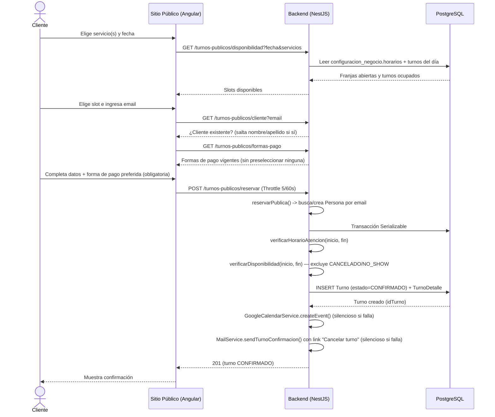

**Reglas que no estaban en la v1.0**:
- El turno nace directo `CONFIRMADO`, no `PENDIENTE`.
- Se valida el horario de atención real del negocio (día cerrado o fuera de franja → 400), no solo el solapamiento.
- La forma de pago preferida es obligatoria en este flujo (no en el alta manual).
- El endpoint está limitado a 5 reservas por minuto por IP (rate limiting).
- El teléfono se normaliza a solo dígitos y tiene que tener entre 8 y 15 (si no, 400).
- El mail de confirmación incluye un link firmado para que el cliente cancele solo (ver 1.9).

### 1.2. Alta manual de turno – panel (dueño)

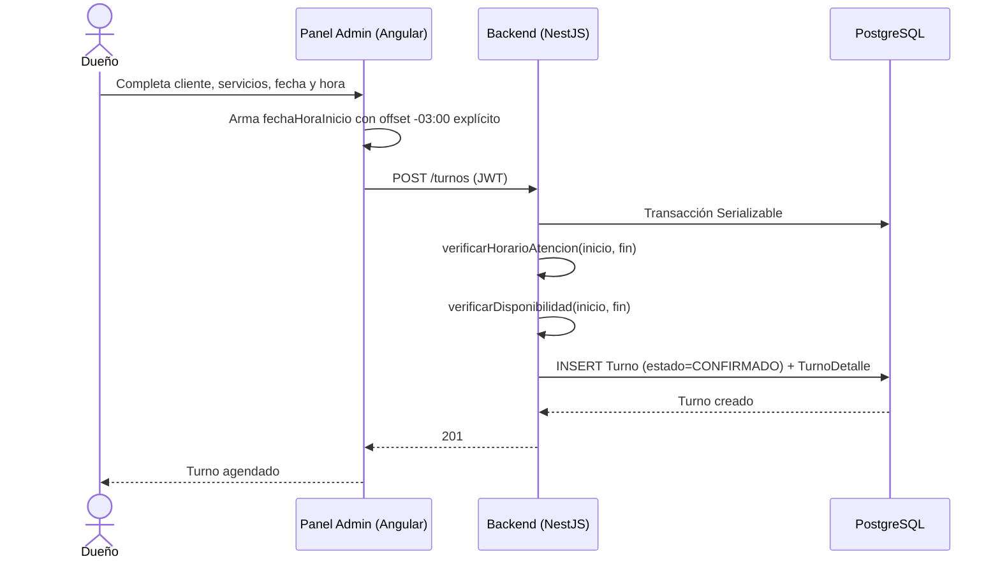

**Nota de huso horario**: el frontend construye la fecha con el offset `-03:00` fijo (hora
de Argentina, sin horario de verano), no como string ambiguo — necesario porque el backend
está hosteado en un VPS fuera de Argentina, y un string sin zona horaria se interpretaría
con la hora local del servidor.

### 1.3. Transición automática de turnos por reloj (cron)

Nuevo — no existía en la v1.0. Es el cambio de estrategia central: el sistema avanza los
turnos solo, y el dueño (que también atiende) solo interviene para las excepciones
(cancelar, no-show).

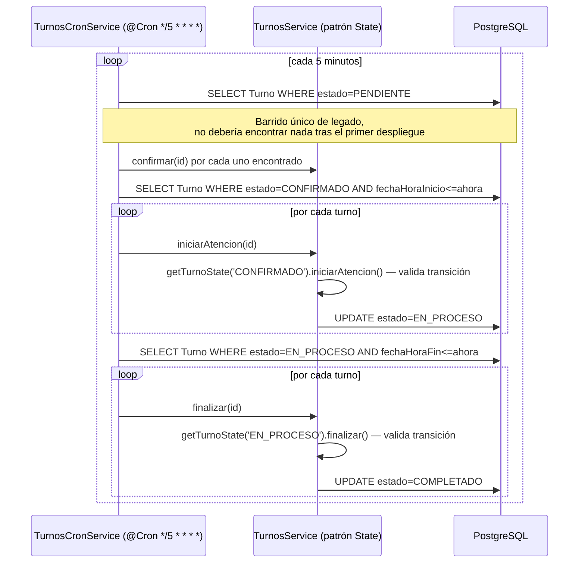

**Por qué es seguro**: el cron nunca escribe `estado` directo — siempre llama a los mismos
métodos del servicio que usa el panel manual, así que pasa por la misma validación del
patrón State. Un error en un turno (try/catch por turno) no frena el resto del lote.
`CANCELADO` y `NO_SHOW` nunca se tocan automáticamente: son siempre decisión manual del
dueño.

### 1.4. Login con verificación en dos pasos (2FA por email)

Nuevo — no existía en la v1.0.

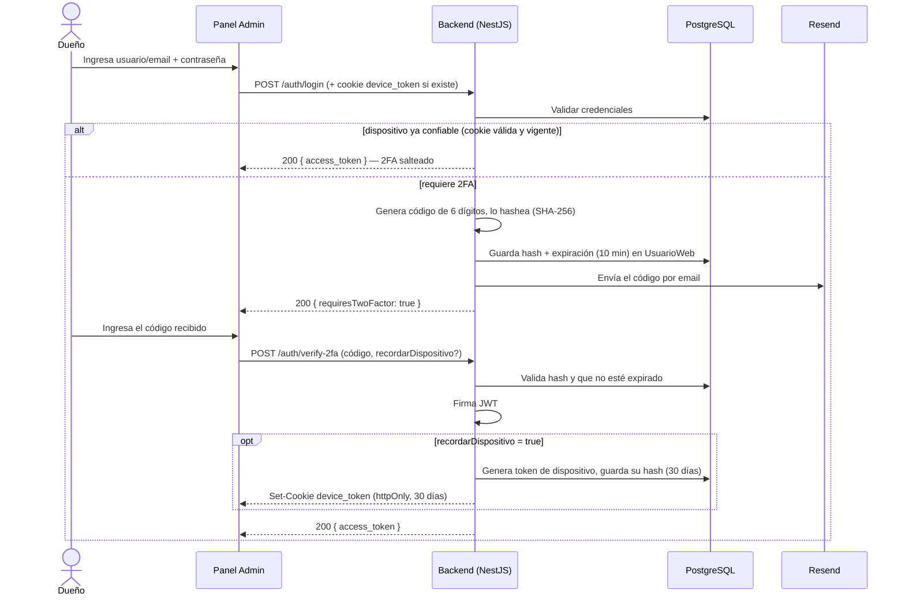

### 1.5. Cobrar en caja

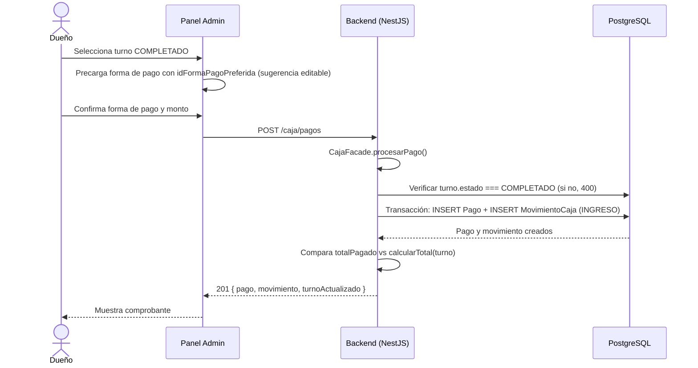

**Nota**: no existe un estado `PAGADO` separado. El turno queda `COMPLETADO`; el pago (o
los pagos parciales) se registran aparte en `Pago`/`MovimientoCaja`, y `turnoActualizado`
le dice al frontend si ya está completamente cobrado.

### 1.6. Cancelar turno

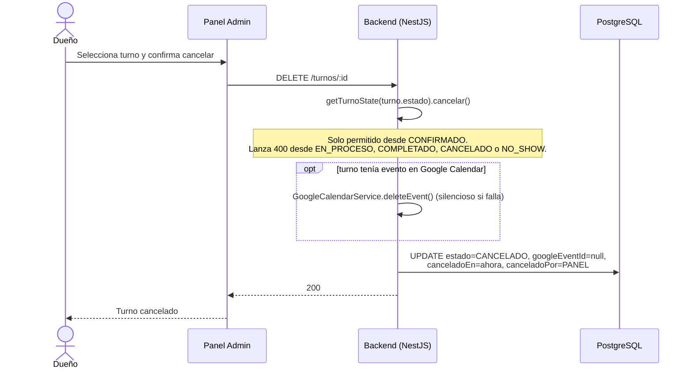

El cliente también puede cancelar por su cuenta desde el mail: ver 1.9.

### 1.7. Cierre de caja diario

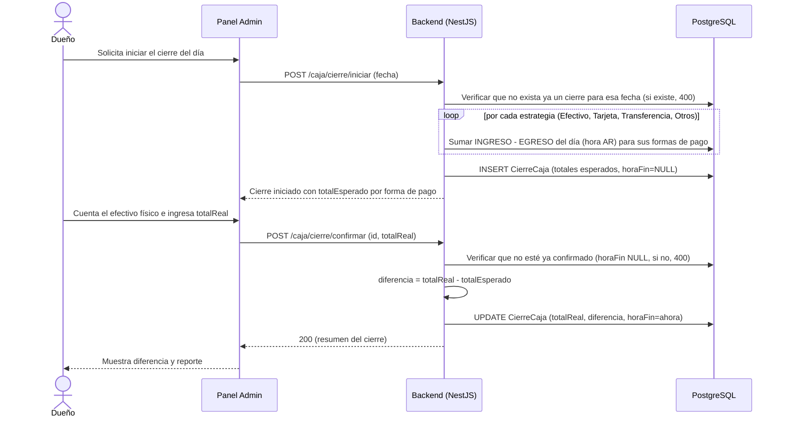

### 1.8. Recordatorio automático por email (cron)

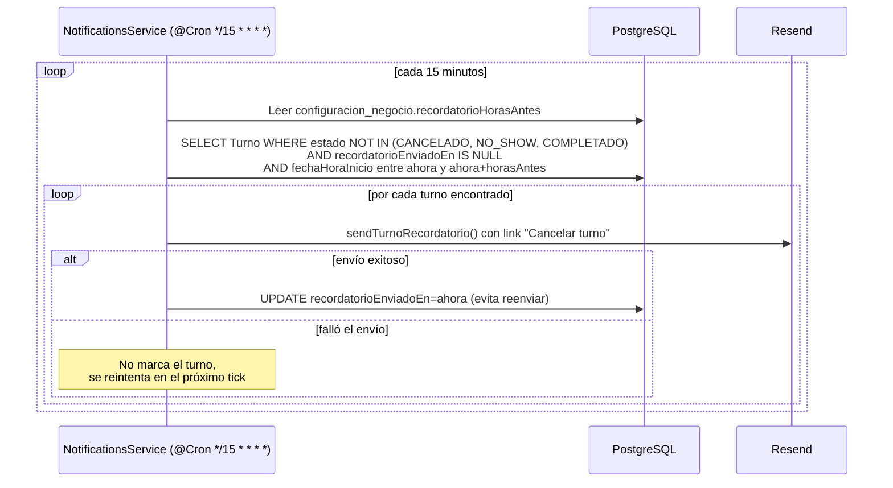

### 1.9. Cancelar turno desde el mail (cliente)

Nuevo en la v2.1. El mail de confirmación (1.1) y el de recordatorio (1.8) traen un botón
"Cancelar turno" con un token firmado (HMAC del id del turno con `JWT_SECRET`; no se guarda
nada en la base). El cliente puede cancelar **siempre**, sin límite de horas, mientras el
turno no haya empezado: se prefirió eso a bloquear la cancelación cerca del horario, porque
un cliente bloqueado suele no avisar y directamente no ir.

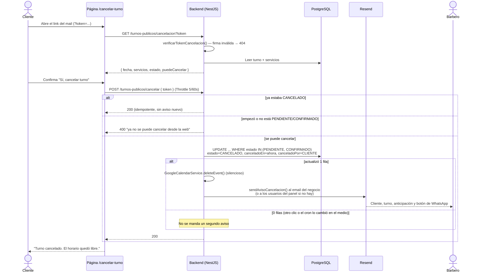

El horario queda libre en la web al instante: la disponibilidad ya excluye los turnos
`CANCELADO`. El aviso al barbero es best effort: si falla, la cancelación queda hecha igual.

### 1.10. Vender un producto en caja

Nuevo en la v2.1.

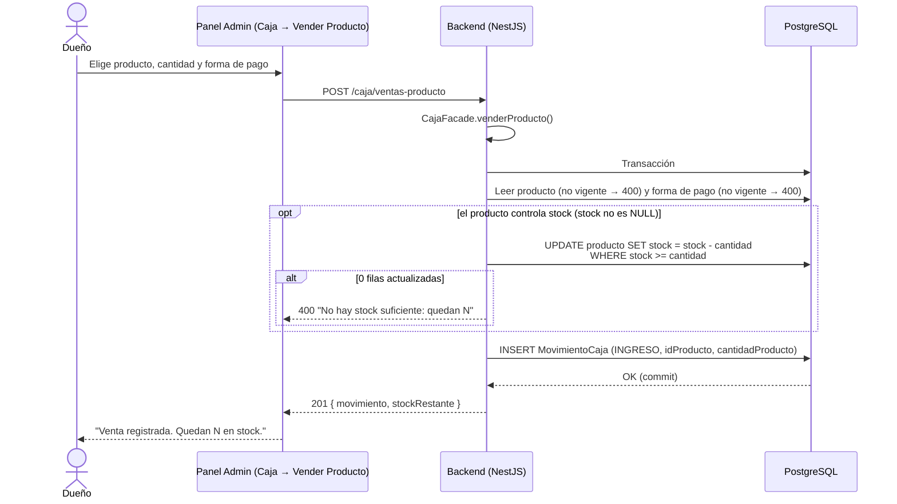

El ingreso entra al cierre de caja como cualquier otro movimiento. Si un producto queda en su
stock mínimo o en 0, el dashboard lo avisa (`GET /productos/stock-bajo`) y la tienda de la web
lo muestra como "Sin stock".

### 1.11. Marcar que el cliente no vino

Nuevo en la v2.1. Antes `NO_SHOW` solo se podía marcar desde `CONFIRMADO`, pero el cron pasa el
turno a `EN_PROCESO` a la hora de inicio: cuando el dueño se daba cuenta de que el cliente no
había venido, el turno ya no estaba confirmado y la transición se rechazaba.

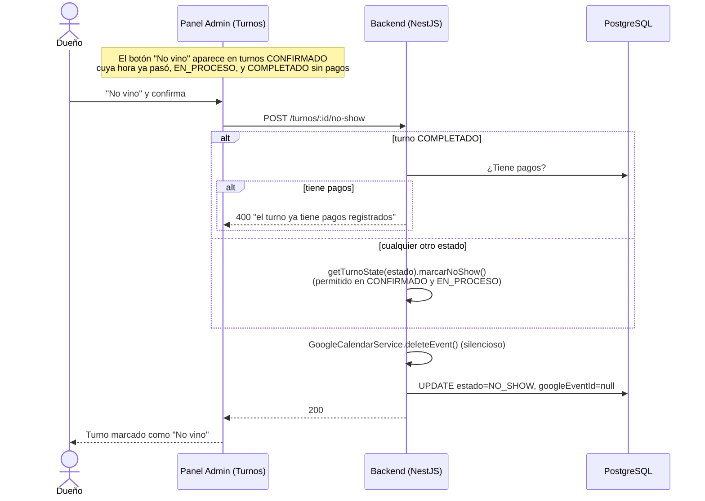

Un turno `NO_SHOW` no cuenta como visita para la fidelización (solo cuentan los `COMPLETADO`).

---

## 2. Diagrama de Estados – Turno

**Estados reales**: `CONFIRMADO`, `EN_PROCESO`, `COMPLETADO`, `CANCELADO`, `NO_SHOW`.
`PENDIENTE` sigue existiendo en el código (patrón State completo, por compatibilidad) pero
ningún turno nuevo nace ahí — es un estado de transición única para turnos viejos, barrido
automáticamente a `CONFIRMADO` por el cron la primera vez que corre tras el despliegue de
este cambio.

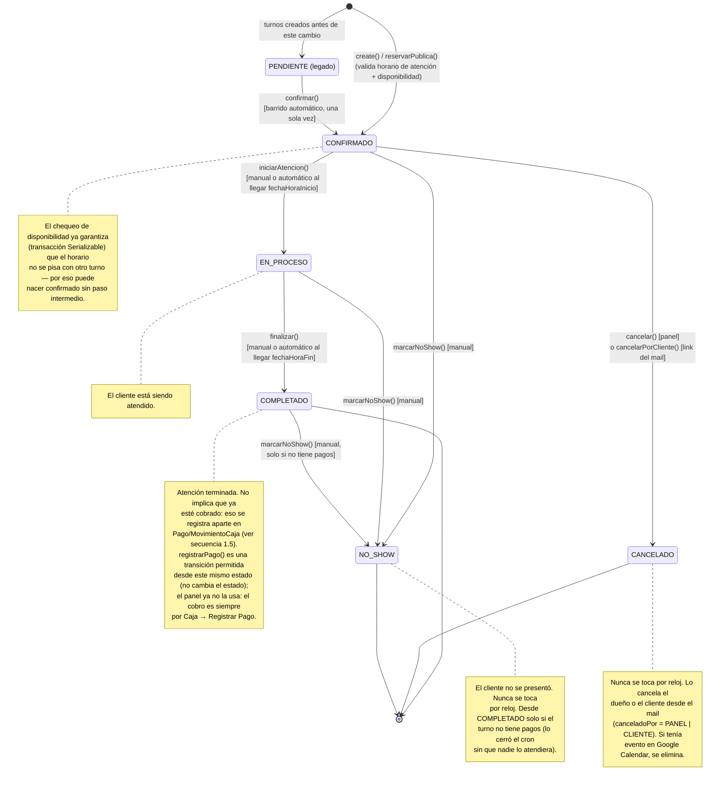

---

## 3. Diagrama de Actividades – Flujo del Día

Actualizado: la mayoría de los turnos ya llegan agendados desde el sitio público y
avanzan solos por el cron; el dueño interviene sobre todo para cobrar, para las
excepciones (cancelar/no-show) y para los walk-ins sin turno previo.

```mermaid
flowchart TD
    A([Inicio del día]) --> B[El cron corre cada 5 min<br/>de fondo todo el día]
    B --> C{¿Llega un cliente?}
    C -->|Con turno agendado online| D[El turno ya está CONFIRMADO<br/>y el cron lo pasó a EN_PROCESO solo]
    C -->|Walk-in sin turno| E[Dueño crea el turno a mano<br/>nace CONFIRMADO]
    E --> F[Dueño inicia la atención a mano<br/>iniciarAtencion]
    D --> G[Atiende al cliente]
    F --> G

    G --> H{¿Termina justo a la hora prevista?}
    H -->|Sí| I[El cron lo pasa solo a COMPLETADO]
    H -->|No, termina antes/después| J[Dueño finaliza a mano<br/>finalizar]
    I --> K
    J --> K[Turno COMPLETADO]

    K --> L{¿Cobra ahora?}
    L -->|Sí| M[Selecciona forma de pago<br/>precargada con la preferida del cliente]
    M --> N[Registra el pago -> genera movimiento de caja]
    L -->|No| O[Deja el cobro pendiente<br/>para más tarde]

    N --> P{¿Hubo un problema con este turno?}
    O --> P
    P -->|Cliente no se presentó| Q[Dueño toca 'No vino'<br/>NO_SHOW]
    P -->|Se canceló antes de atender| R[Lo cancela el dueño, o el cliente<br/>desde el mail con aviso al barbero;<br/>el horario queda libre]
    P -->|Todo normal| S{¿Más clientes?}
    Q --> S
    R --> S

    S -->|Sí| C
    S -->|No| T[Fin de atención del día]
    S -.->|Venta de mostrador| VP[Caja → Vender Producto<br/>ingreso + descuento de stock]
    VP -.-> S
    T --> U[Dueño inicia el cierre de caja<br/>POST /caja/cierre/iniciar]
    U --> V[Sistema calcula lo esperado<br/>por forma de pago, Strategy por cada una]
    V --> W[Dueño cuenta el efectivo físico]
    W --> X[Confirma el cierre con el total real<br/>POST /caja/cierre/confirmar]
    X --> Y{¿Cuadra con lo esperado?}
    Y -->|Sí| Z([Cierre guardado, diferencia = 0])
    Y -->|No| AA[Queda registrada la diferencia<br/>para revisar]
    AA --> Z
```

---

## Resumen

| Diagrama | Propósito |
|----------|-----------|
| **Secuencia (1.1–1.11)** | Interacción paso a paso para cada operación crítica: reserva pública, alta manual, transición automática por cron, login 2FA, cobro, cancelación desde el panel, cierre de caja, recordatorio por email, cancelación por el cliente desde el mail, venta de productos y "No vino". |
| **Estados – Turno** | Ciclo de vida real del turno: nace `CONFIRMADO`, avanza por reloj o a mano, con `CANCELADO` (dueño o cliente) y `NO_SHOW` (manual, también desde `EN_PROCESO` o `COMPLETADO` sin pagos) como excepciones. |
| **Actividades** | Flujo de trabajo de una jornada completa, con la mayoría de los turnos auto-avanzando y el dueño interviniendo solo en excepciones y cobro. |

---

*Ver también: `diagrama-er.md` (entidad-relación), `diagrama-clases.md` (modelo de dominio + patrones), `contexto-proyecto.md` (documento consolidado).*
